$bt = [char]0x60
$ticks = "$bt$bt$bt"

@"
# Fashion Store

A Flutter fashion shopping app with product browsing, search, favorites, a shopping cart, and checkout screens.

## Features

- Browse fashion products and collections
- Search the product catalog
- View product details
- Add products to favorites or the cart
- Change cart quantities
- Navigate through checkout screens

## Run the app

${ticks}bash
git clone https://github.com/Mo82566/fashion-store.git
cd fashion-store
flutter pub get
flutter run
${ticks}

## Screenshots

| Screen 1 | Screen 2 | Screen 3 |
| :---: | :---: | :---: |
|  | 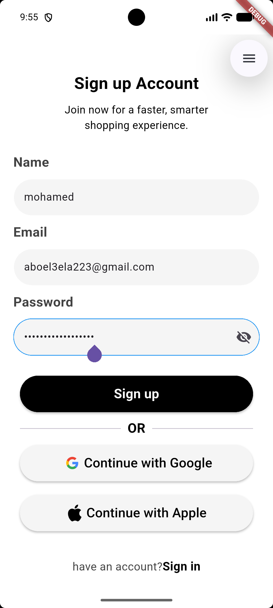 | 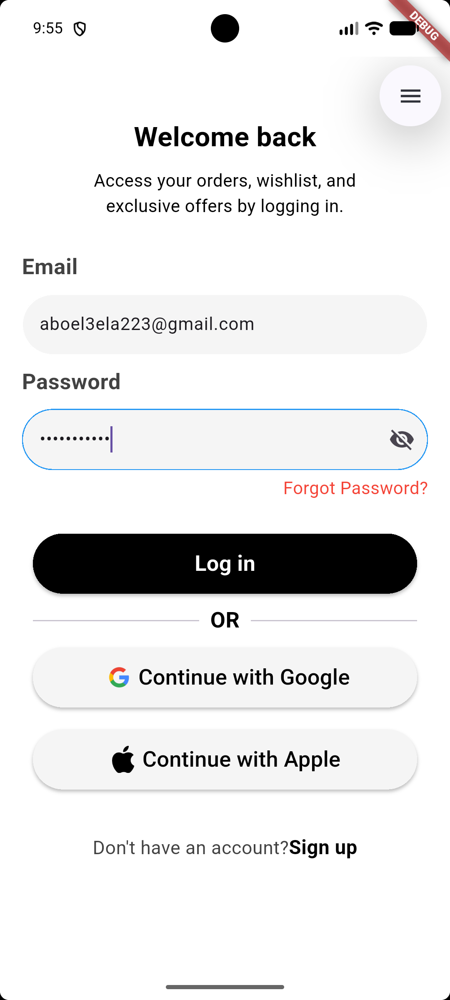 |
|  |  |  |
| 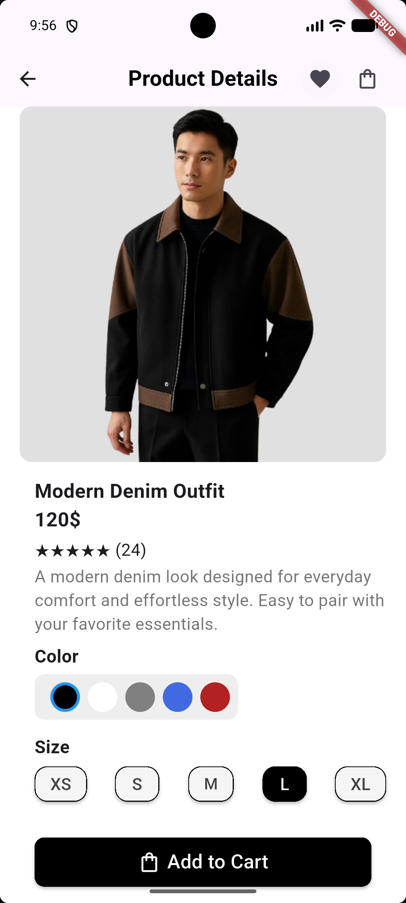 | 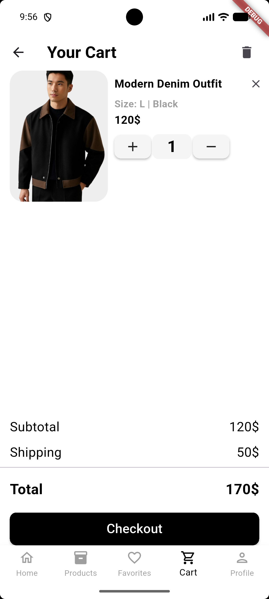 | 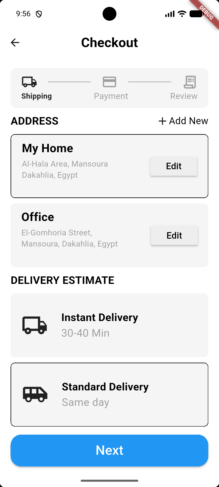 |
| 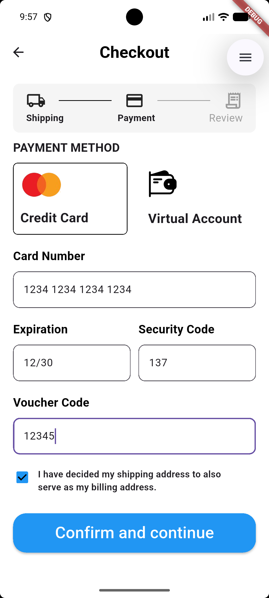 | 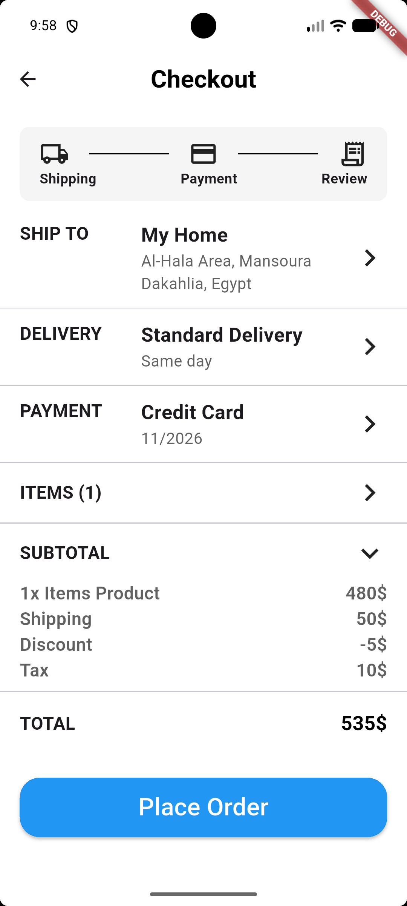 | 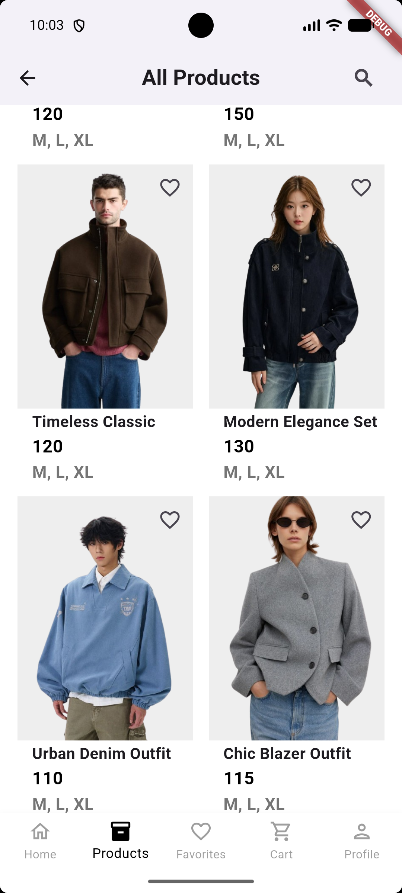 |
| 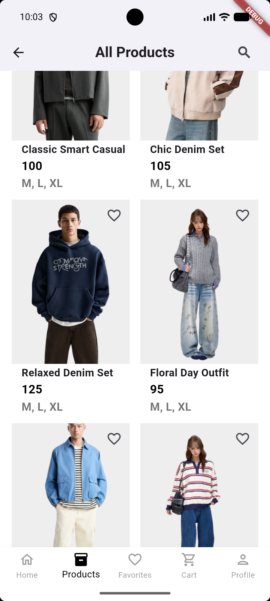 | 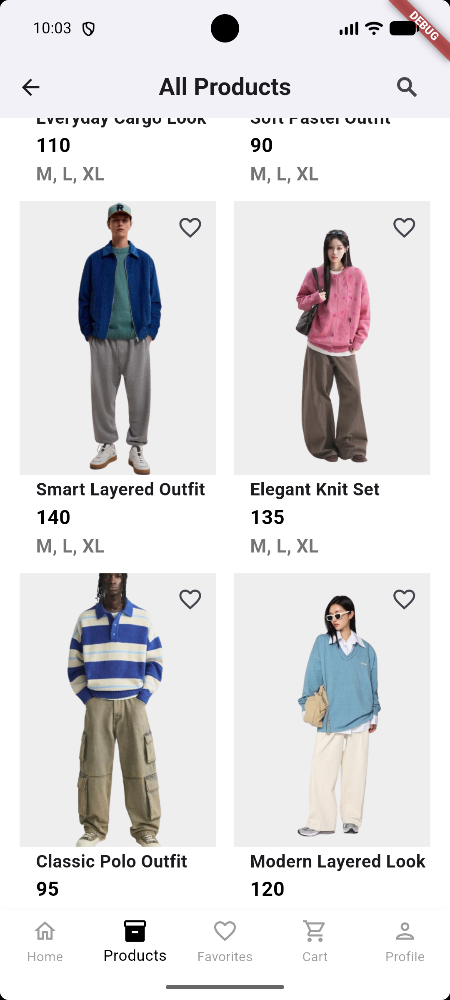 | 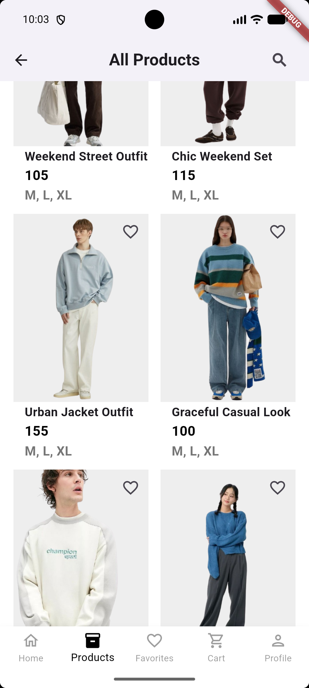 |
| 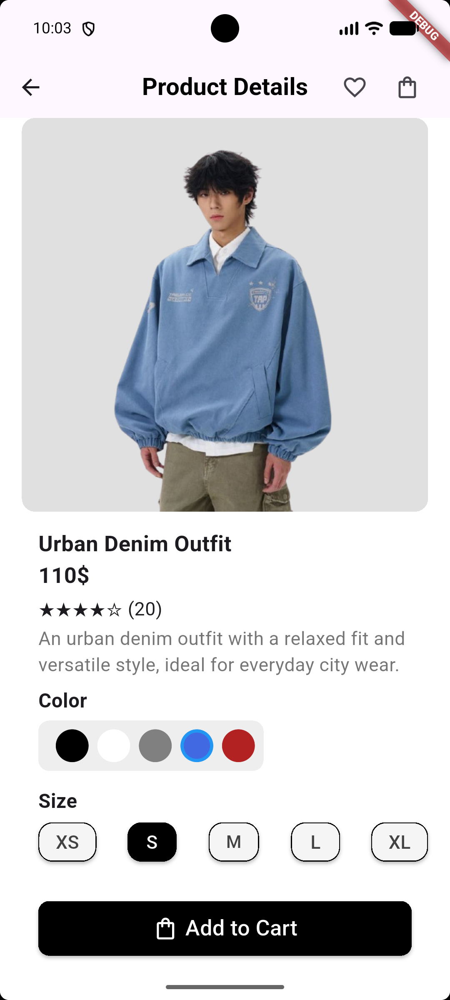 | 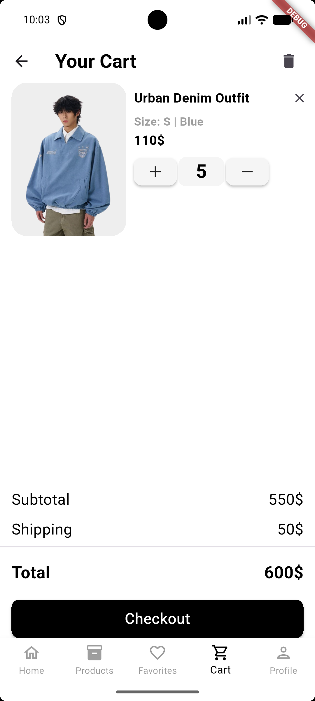 | 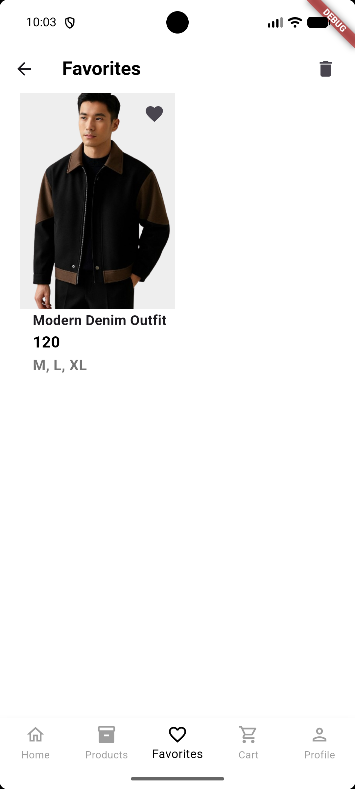 |
| 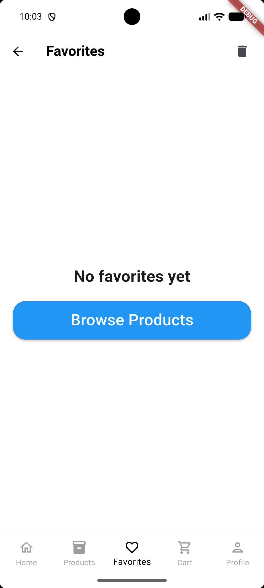 | 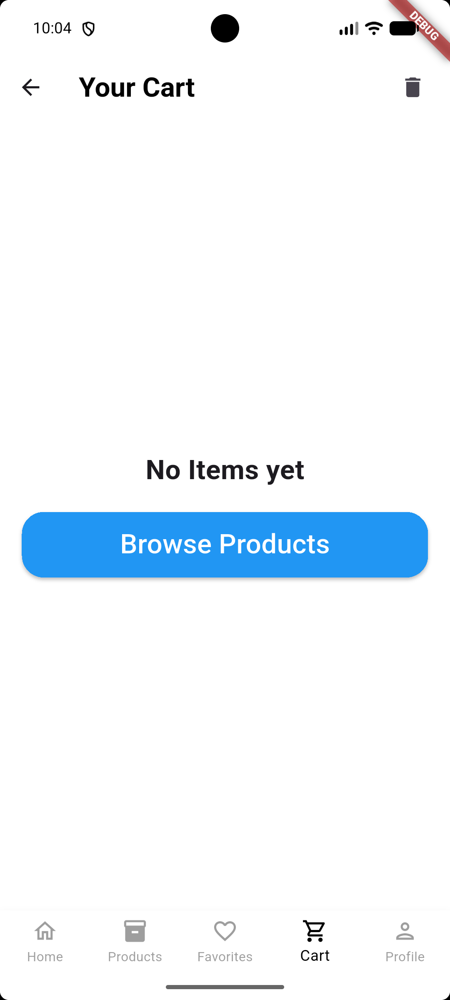 | 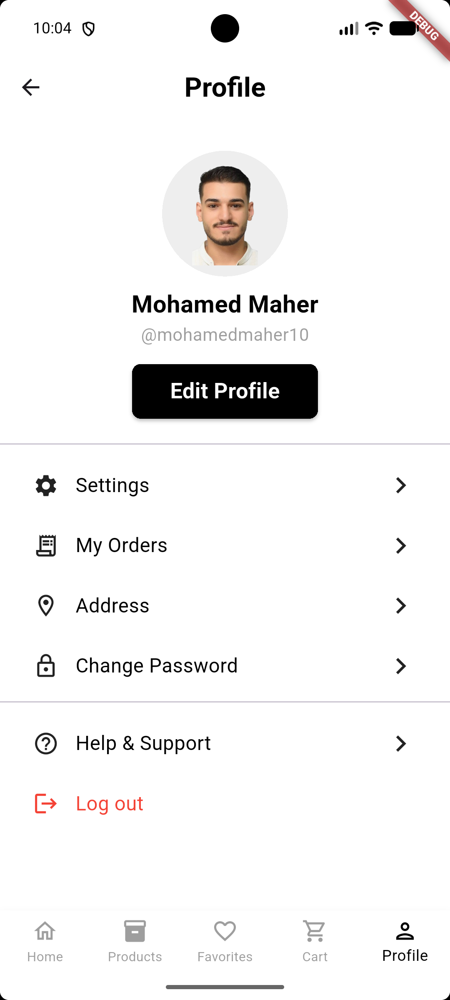 |
| 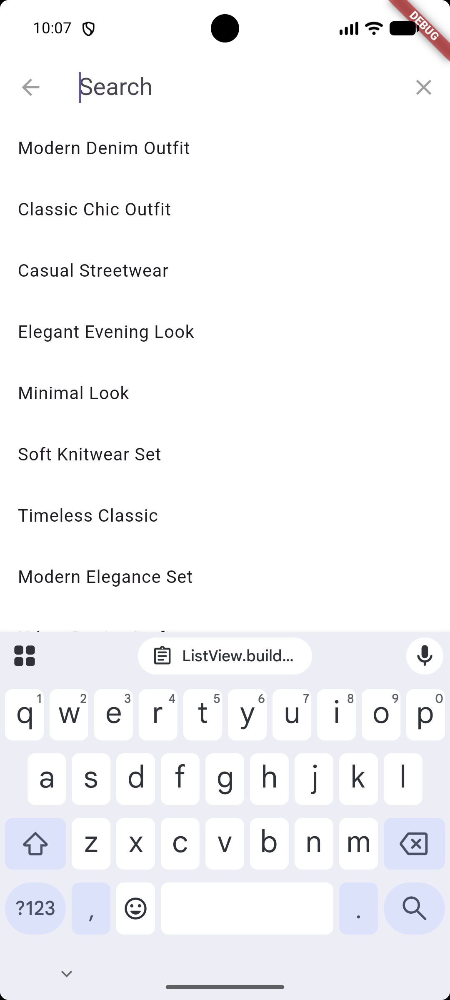 | | |
"@ | Set-Content .\README.md -Encoding UTF8